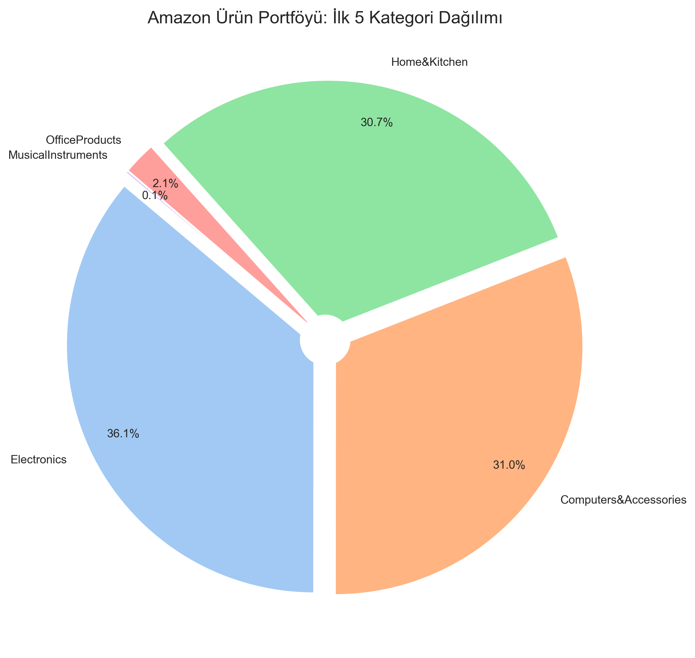

# 📊 Amazon Sales Data Analysis (EDA)

Bu proje, Amazon platformundaki ürünlerin fiyatlandırma stratejilerini, indirim oranlarını ve müşteri geri bildirimleri arasındaki ilişkileri inceleyen kapsamlı bir **Keşifçi Veri Analizi (EDA)** çalışmasıdır.

## 🚀 Proje Özeti
Veri seti, 1400'den fazla Amazon ürününün ham verilerini içermektedir. Analiz süreci; kirli verilerin temizlenmesi, yeni özelliklerin türetilmesi (Feature Engineering) ve verinin görselleştirilmesi aşamalarını kapsar.

## 🛠️ Kullanılan Teknolojiler
* **Python 3.x**
* **Pandas:** Veri manipülasyonu ve temizleme
* **NumPy:** Sayısal hesaplamalar
* **Matplotlib & Seaborn:** Veri görselleştirme

## 📈 Öne Çıkan Bulgular (Key Insights)
* **İndirim Stratejisi:** En yüksek ortalama indirim oranları %60+ ile `Home Improvement` ve `Pet Supplies` kategorilerinde görülmektedir.
* **Fiyat-Rating İlişkisi:** Ürün fiyatı ile müşteri puanı arasında anlamlı bir korelasyon bulunmamıştır. Bu, tüketicilerin sadece fiyata göre değil, ürün kalitesine göre puan verdiğini kanıtlamaktadır.
* **Pazar Dağılımı:** Portföyün büyük bir kısmı `Electronics` ve `Home & Kitchen` kategorilerinden oluşmaktadır.

## 🖼️ Görselleştirmeler

*Amazon ürün portföyünün kategori bazlı dağılımı.*

## 📋 Kurulum ve Çalıştırma
1. Bu depoyu klonlayın: `git clone https://github.com/Abdullahkaynakk/amazon-eda.git`
2. Gerekli kütüphaneleri yükleyin: `pip install pandas matplotlib seaborn`
3. Jupyter Notebook'u açın: `jupyter notebook AmazonEDA.ipynb`
4. Alternatif olarak tüm kütüphaneleri tek seferde yükleyin: `pip install -r requirements.txt`
